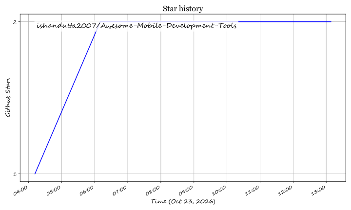

  

# 📱 Awesome Mobile Development Tools

  
  
  
  
  
  

---

> 🚀 **A curated, SEO-optimized directory of premier mobile development frameworks, native toolchains, CI/CD pipelines, cloud device testbeds, and SaaS developer platforms.**  
> Built for mobile engineering leads, iOS & Android architects, and cross-platform teams creating high-performance applications.

---

## 📑 Table of Contents

- [📊 Sector Overview & Market Dynamics](#-sector-overview--market-dynamics)
- [☁️ SaaS & Hosted Cloud Platforms](#️-saas--hosted-cloud-platforms)
- [🛠️ Open-Source Ecosystem](#️-open-source-ecosystem)
- [⚖️ Architectural Comparison & Trade-Off Matrix](#️-architectural-comparison--trade-off-matrix)
- [🤝 How to Contribute](#-how-to-contribute)
- [📈 Star History](#-star-history)
- [💖 Support & Sponsoring](#-support--sponsoring)
- [📜 Disclaimer & License](#-disclaimer--license)

---

## 📊 Sector Overview & Market Dynamics

The global mobile application development and developer tooling market is valued at approximately **$18.5 Billion in 2026** (within the broader $240+ Billion mobile application software economy) and is projected to expand at a **CAGR of ~21.4%** through 2030, driven by the rapid growth of enterprise cross-platform frameworks, automated mobile DevOps pipelines, and AI-assisted application synthesis.

Market dynamics exhibit a **two-tiered structure**: it is **highly concentrated (winner-take-all duopoly)** at the core operating system and native execution runtime layer strictly governed by Apple (iOS, Swift, Xcode) and Google (Android, Kotlin, Android Studio), yet **moderately to highly fragmented** across the developer productivity layers — including cross-platform runtimes (Flutter, React Native), specialized mobile CI/CD platforms (Bitrise, Codemagic), cloud physical device testbeds (BrowserStack), in-app subscription engines (RevenueCat), and automated app security hardening (Appdome).

---

## ☁️ SaaS & Hosted Cloud Platforms

The table below catalogs premier SaaS and hosted cloud platforms for mobile engineering teams. Entries are **sorted descending by company scale (Valuation / Market Cap / Revenue)**.

| Platform & Provider | Category / Core Focus | Company Scale (Valuation / Revenue) 🏢 | Starting Paid Tier Pricing 💰 | Free Tier & Trial Limits 🎁 |
| :--- | :--- | :--- | :--- | :--- |
| [**Apple Xcode Cloud**](https://developer.apple.com/xcode-cloud/) | Native iOS/macOS CI/CD, Automated Testing & TestFlight Delivery | **~$3.50 Trillion** Market Cap (~$391B Annual Revenue) | **$25.00/month** for 25 compute hours/mo pack (requires $99/year Apple Developer Program) | **25 compute hours/month free forever** included with active Apple Developer Program membership |
| [**Microsoft GitHub Actions for Mobile**](https://github.com/features/actions) | Cloud Mobile CI/CD, Native Workflows & Multi-Runner Pipelines | **~$3.10 Trillion** Market Cap (~$245B Annual Revenue) | **$4.00/user/month** (GitHub Team plan; standard macOS runners start at $0.08/min beyond included quota) | **2,000 build minutes/month free forever** on Linux/Windows (or 500 MB package storage); **100% free with unlimited minutes** for public open-source repos |
| [**Google Firebase & Cloud Build**](https://firebase.google.com/) | Mobile BaaS, Crashlytics, Real Device Test Lab & Build Automation | **~$2.15 Trillion** Market Cap (~$307B Annual Revenue) | **Pay-as-you-go Blaze Tier** (starts at $0.01 per additional GB/invocation after free allowances; Cloud Build at $0.003/build-min) | **Spark Plan (free forever)**: 1 GB Firestore data, 20k writes/day, 10k phone auths/month, 15 daily Test Lab runs (10 virtual, 5 physical), and 120 free build-minutes/day |
| [**Datadog Mobile RUM**](https://www.datadoghq.com/product/mobile-rum/) | Mobile Real User Monitoring (RUM), Crash Reporting & APM | **~$42.0 Billion** Market Cap (~$2.13B Annual Revenue) | **$1.50 per 1,000 mobile sessions/month** (billed annually; Pro APM starts at $31.00/host/month) | **14-day free trial** with full access to Mobile RUM and APM features, up to 5 hosts and unlimited test sessions without credit card requirement |
| [**BrowserStack App Live & Automate**](https://www.browserstack.com/app-live) | Real Mobile Device Cloud, Interactive Testing & CI Automation | **~$4.00 Billion** Valuation (~$200M+ Annual Revenue) | **$29.00/month** (billed annually at $348/year for App Live individual plan; App Automate from $199.00/month) | **Free trial with 30 minutes of interactive testing** on physical iOS/Android real devices and 100 minutes of automated app testing |
| [**Bitrise**](https://bitrise.io/) | Specialized Mobile DevOps, Automated Store Publishing & Pipelines | **~$600 Million** Valuation (~$50M ARR) | **$41.50/month** (Starter credit pack base, billed annually) or **$99.00/concurrency/month** for dedicated teams | **Hobby Plan (free forever)**: 1 concurrent build, 300 build minutes/month, and max 30-minute execution limit per build |
| [**RevenueCat**](https://www.revenuecat.com/) | In-App Purchases, StoreKit/Google Play Subscriptions & LTV Analytics | **~$300 Million** Valuation (~$30M ARR) | **$119.00/month** for Pro Plan (or 1% of Monthly Tracked Revenue above $2,500 threshold) | **Free forever plan for up to $2,500 Monthly Tracked Revenue (MTR)** with unlimited app users, revenue charts, and webhook integrations |
| [**Expo EAS**](https://expo.dev/eas) | React Native/Expo Cloud Builds, Over-the-Air (OTA) Updates & Submit | **~$300 Million** Valuation (~$20M ARR) | **$99.00/month** ($1,188/year) for Production Plan with 100 build credits and priority build queues | **Free forever plan**: 30 build credits/month on standard shared queue, 1 concurrent build, and free OTA updates for up to 1,000 monthly active users (MAUs) |
| [**Appdome**](https://www.appdome.com/) | Mobile App Cyber Defense, Anti-Tampering, Obfuscation & Hardening | **~$250 Million** Valuation (~$25M ARR) | **$350.00/app/month** (Secure Start tier, billed annually) for automated binary security integration | **30-day free trial** with 5 free automated security build integrations and mobile app threat vulnerability assessments |
| [**Codemagic**](https://codemagic.io/) | Dedicated Mobile CI/CD for Flutter, React Native, iOS & Android | **~$12.0 Million** Annual Recurring Revenue (ARR) | **$299.00/month** for Professional Plan (3 concurrent builds & unlimited standard VM minutes) or $0.045/min on M2/M3 runners | **Free forever plan**: 500 build minutes/month and 1 concurrent build on standard macOS and Linux virtual machines |

> ℹ️ *Note on Deprecated Platforms*: **Microsoft Visual Studio App Center** was officially **retired on March 31, 2025**. Teams building new pipelines should migrate to modern CI alternatives (GitHub Actions, Bitrise, Codemagic) and crash analytics to Firebase Crashlytics or Datadog Mobile RUM.

---

## 🛠️ Open-Source Ecosystem

The open-source mobile development ecosystem powers modern client architectures worldwide. Every repository below is **sorted in descending order by GitHub_Stars**, and includes a live social Stars_Badge linking directly to the project's stargazers page.

1. **[Flutter](https://github.com/flutter/flutter)**  `[Cross-Platform UI Framework]`  
   Google's flagship multi-platform UI framework written in Dart and C++. Compiles directly to ARM/x86 native machine code for iOS, Android, macOS, Windows, Linux, and Web from a single unified codebase. Employs the high-performance Impeller rendering engine for smooth 120 FPS animations without reliance on platform OEM widgets.  
   *License: BSD-3-Clause*

2. **[React Native](https://github.com/facebook/react-native)**  `[Cross-Platform UI Framework]`  
   Meta's widely adopted framework for building native mobile applications using JavaScript/TypeScript and React. Powered by the **New Architecture** (Fabric concurrent renderer, Hermes JavaScript engine, and TurboModules JSI bridge), eliminating legacy async serialization bottlenecks and enabling direct synchronous C++ communication with native platform APIs.  
   *License: MIT*

3. **[Kotlin & Kotlin Multiplatform](https://github.com/JetBrains/kotlin)**  `[Language & Shared Logic]`  
   JetBrains' modern statically-typed programming language and multiplatform architecture (KMP). Empowers engineering teams to write core business logic, networking, and data storage once in Kotlin, while maintaining 100% native platform UI fidelity through Jetpack Compose on Android and SwiftUI on iOS. Officially endorsed by Google for Android development.  
   *License: Apache-2.0*

4. **[Expo](https://github.com/expo/expo)**  `[React Native Framework & Tooling]`  
   The complete developer framework and tooling ecosystem for React Native applications. Offers file-based routing via Expo Router, universal native modules, prebuilding (CNG - Continuous Native Generation), and frictionless deployment without needing direct Xcode or Android Studio configuration for everyday app logic.  
   *License: MIT*

5. **[Ionic Framework](https://github.com/ionic-team/ionic-framework)**  `[Hybrid Mobile UI Framework]`  
   Comprehensive mobile UI toolkit for building fast, cross-platform mobile, desktop, and Progressive Web Apps (PWAs) using standard web technologies (HTML, CSS, TypeScript) with modern front-end frameworks like React, Vue, and Angular.  
   *License: MIT*

6. **[Fastlane](https://github.com/fastlane/fastlane)**  `[Build & Release Automation]`  
   The definitive open-source automation engine for iOS and Android release pipelines. Automates cryptographic code signing management (`match`), screenshot generation (`snapshot`), TestFlight/Google Play beta distribution (`pilot`), and App Store metadata updates (`deliver`). Integrates into any CI environment.  
   *License: MIT*

7. **[Lottie Android](https://github.com/airbnb/lottie-android)**  `[Vector Motion & UI Engine]`  
   Airbnb's native vector animation rendering engine for Android. Parses Adobe After Effects animations exported as lightweight JSON files with Bodymovin, executing rich interactive motion design on device without bitmap overhead.  
   *License: Apache-2.0*

8. **[NativeScript](https://github.com/NativeScript/NativeScript)**  `[Native JavaScript Framework]`  
   Open-source framework for building truly native apps using JavaScript, TypeScript, Angular, or Vue. Offers direct, transparent access to 100% of native iOS and Android APIs without requiring third-party wrapper plugins or native code bridges.  
   *License: Apache-2.0*

9. **[Appium](https://github.com/appium/appium)**  `[Cross-Platform Test Automation]`  
   Open-source, cross-platform test automation tool for native, hybrid, and mobile web applications on iOS, Android, and Windows. Implements the standard W3C WebDriver protocol, allowing tests to be written in Python, Java, JavaScript, Ruby, or C#.  
   *License: Apache-2.0*

10. **[Compose Multiplatform](https://github.com/JetBrains/compose-multiplatform)**  `[Shared Declarative UI]`  
    JetBrains' declarative UI toolkit based on Google's Jetpack Compose. Allows mobile teams to share interactive UI code directly between Android and iOS (as well as Desktop and Web), delivering unified UI states without sacrificing platform responsiveness.  
    *License: Apache-2.0*

11. **[Capacitor](https://github.com/ionic-team/capacitor)**  `[Native Web Runtime Bridge]`  
    A modern native runtime created by the Ionic team. Wraps web applications in a native shell while providing a clean Swift/Kotlin plugin bridge for device hardware APIs like camera, biometrics, filesystem, and push notifications.  
    *License: MIT*

12. **[Realm Swift](https://github.com/realm/realm-swift)**  `[Embedded Mobile Database]`  
    Fast, modern embedded object database built specifically for Swift and SwiftUI on iOS, macOS, watchOS, and visionOS. Acts as an efficient, developer-friendly alternative to SQLite and Core Data with native live object reactivity and thread-safe models.  
    *License: Apache-2.0*

13. **[Maestro](https://github.com/mobile-dev-inc/maestro)**  `[Declarative UI Testing]`  
    Next-generation, developer-friendly mobile UI automation tool built by Mobile.dev. Uses declarative YAML flows to define end-to-end interactions across Android and iOS apps with built-in resilience against animations, network latency, and flakiness.  
    *License: Apache-2.0*

14. **[Flipper](https://github.com/facebook/flipper)**  `[Desktop Mobile Debugger]`  
    Meta's extensible desktop developer platform for debugging iOS, Android, and React Native applications. Features real-time network inspection, view hierarchy debugging, local database manipulation, and shared crash logs.  
    *License: MIT*

15. **[Detox](https://github.com/wix/Detox)**  `[Gray-Box E2E Testing]`  
    Gray-box end-to-end testing and automation library engineered by Wix for React Native and native mobile applications. Synchronizes directly with the application runtime (network, main thread, animation queue) to ensure completely deterministic, flake-free CI execution.  
    *License: MIT*

16. **[Tuist](https://github.com/tuist/tuist)**  `[Xcode Modular Build Acceleration]`  
    Command-line productivity tool that automates the generation and maintenance of modular Xcode projects and workspaces. Eliminates git merge conflicts in `.xcodeproj` files and speeds up clean build times drastically via binary caching.  
    *License: MIT*

---

## ⚖️ Architectural Comparison & Trade-Off Matrix

| Architectural Approach | Core Technologies | Primary Advantages | Inherent Trade-offs | Ideal Team Profile |
| :--- | :--- | :--- | :--- | :--- |
| **Native Dual-Stack** | Swift (SwiftUI) & Kotlin (Compose) | Zero abstraction latency, instantaneous Day-0 platform API access, smallest binary footprint (~3-8 MB). | Duplicate engineering effort; requires two distinct engineering teams and separate bug tracks. | Large enterprises with platform-specific UX requirements and dedicated iOS/Android teams. |
| **Cross-Platform Widget Engine** | Flutter (Dart, Impeller) | Pixel-perfect UI consistency across platforms, rapid hot-reload iteration, high rendering framerate. | Dart ecosystem is smaller than JavaScript; larger initial binary size (~12-20 MB); custom styling required for native look. | Teams prioritizing UI brand uniformity across mobile, web, and desktop with unified codebase. |
| **JavaScript/TypeScript Bridge** | React Native & Expo | Massive npm ecosystem, universal web/mobile talent pool, Over-the-Air (OTA) JavaScript hot updates. | Multi-package manager coordination (npm + CocoaPods/SPM + Gradle); heavier runtime footprint. | Web-fluent teams wanting fast time-to-market, shared React skills, and instant OTA patch delivery. |
| **Shared Logic / Native UI** | Kotlin Multiplatform (KMP) | Code sharing for business logic, networking, and analytics while preserving 100% native UI fidelity. | Dual UI maintenance required (SwiftUI for iOS, Compose for Android); iOS tooling setup overhead. | Teams with existing Android and iOS developers looking to reduce duplicated business logic safely. |
| **Hybrid Web Runtime** | Ionic & Capacitor | Reuses standard responsive HTML/CSS/JS web applications; lowest barrier to entry for web engineers. | WebView performance bounds; intensive 60-120 FPS gestures and GPU transitions require optimization. | Content-driven apps, internal enterprise tools, and teams wanting to repackage web portals into mobile stores. |

---

## 🤝 How to Contribute

Contributions from the mobile engineering community are warmly welcomed! To suggest a new tool, update an existing entry, or refine pricing/metrics:

1. 🍴 **Fork the repository** on GitHub.
2. 🌿 **Create a new branch**: `git checkout -b feature/add-new-mobile-tool`.
3. 📝 **Add or update the tool** in `README.md` following the established formatting, exact pricing standards, and verified Stars_Badges.
4. 🔍 **Verify links and badges**: Ensure all URLs are active and live Stars_Badges link to `/stargazers`.
5. 📬 **Submit a Pull Request** with a concise description of the tool and why it adds value to the ecosystem.

---

## 📈 Star History

---

## 💖 Support & Sponsoring

Thank you for visiting **Awesome Mobile Development Tools**! If this curated ecosystem guide assists you in evaluating mobile platforms, optimizing CI/CD workflows, or building apps:

- ⭐ **Star this repository** to improve discoverability for other mobile developers.
- 🍴 **Fork the project** and bookmark it for architectural reference.
- 📢 **Share with your colleagues**, mobile meetups, and developer networks.
- ☕ **Sponsor continuous updates**: Consider supporting ongoing curation and maintenance via the [GitHub Sponsor Dashboard](https://github.com/sponsors/ishandutta2007).

---

## 📜 Disclaimer & License

- *Disclaimer*: This repository is an independently curated educational directory. Product names, logos, and brands are the property of their respective trademark holders. Mention does not constitute an endorsement.
- *Licensing*: Distributed under the [MIT License](LICENSE).

## Star History

<a href="https://star-history.com/#ishandutta2007/Awesome-Mobile-Development-Tools&Timeline" align="center">
  <picture>
    <source media="(prefers-color-scheme: dark)" srcset="assets/ishandutta2007_Awesome-Mobile-Development-Tools_growth.svg">
    
  </picture>
</a>
